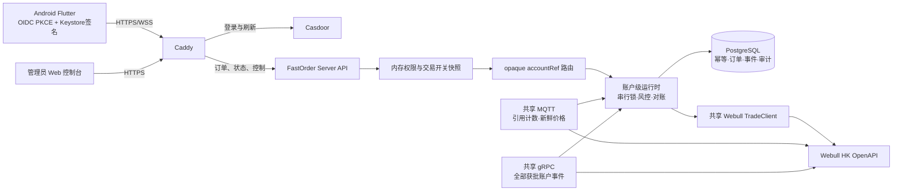

# FastOrder 第一阶段架构

边界与不变量：

- Casdoor 不进入订单热路径；FastOrder 本地验证 JWT、设备 P-256 签名和 nonce，再读取不可变内存控制快照。
- 手机只持有 `accountRef`、别名和脱敏尾号。真实账户 ID 仅在 PostgreSQL 中加密保存，并只在服务器内映射给 Webull SDK。
- 每个账户的下单、改单、撤单串行；不同账户可并行。所有交易操作共享机构级 15 req/s 令牌桶。
- 全局、用户或账户交易开关关闭后仍可查询和撤单；用户禁用、设备撤销或账户解绑则完全拒绝。
- PostgreSQL、行情、订单事件或启动对账不健康时 fail-closed。重启后全局交易必定为关闭。
- 客户端网络超时只轮询原 `Idempotency-Key`，绝不自动重发交易命令。
