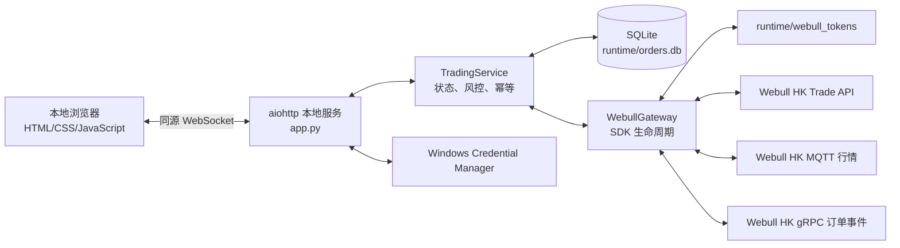

# 极速下单：项目概述与交接文档

> 文档日期：2026-09-04  
> 当前用途：单用户、自有 Webull HK OpenAPI 账户、本地 Windows 主机上的美股单票交易终端  
> 项目根目录：`E:\python\Multi-broker trading\极速下单`

## 1. 项目摘要

“极速下单”是一个完全独立于父项目的本地网页交易工具。它只监听 `127.0.0.1`，使用 Webull HK OpenAPI 账户连接券商，任一时刻只维护一只美股的行情、持仓和下单操作。

项目的核心目标是：

- 保持部署和运行轻量，不引入前端构建链或桌面容器。
- 让操作者能够搜索并切换一只美股，查看实时行情、盘口、最新成交、账户持仓和美元购买力。
- 支持美股整股 `BUY`/`SELL`、`MARKET`/`LIMIT`、`DAY`、`CORE` 常规交易时段订单。
- 在 LIVE 模式开启交易开关后，买入或卖出按钮单击即提交，不提供订单预览接口或二次确认。
- 用服务端风控、行情健康门禁、持仓约束、订单幂等和超时对账降低误单及重复成交风险。
- 使用本地网页上的原创 Liquid Glass 视觉风格，同时保持原生 HTML、CSS 和 JavaScript。

本项目不是多用户平台、代客下单系统或面向公众的券商前端。它不应直接扩展为管理第三方账户和资金的商业服务。

## 2. 当前交付状态

截至本交接文档生成时，自动检查结果如下：

| 检查项 | 结果 |
|---|---|
| Python自动化测试 | `98 passed` |
| Python `compileall` | 通过 |
| `node --check static/app.js` | 通过 |
| `pip check` | 无依赖冲突 |
| 父项目源码依赖 | 无 |
| 远程前端资源/CDN | 无 |
| 符号链接或目录联接 | 无 |

本次测试命令：

```powershell
.\.venv\Scripts\python.exe -m pytest -q --basetemp=.pytest-handoff-20260904
```

说明：默认系统临时目录 `C:\Users\Perspective\AppData\Local\Temp\pytest-of-Perspective` 当前存在 Windows 权限拒绝问题。直接执行普通 `pytest` 时，部分使用 `tmp_path` 的测试可能无法创建临时目录。这不是项目逻辑失败；指定项目内全新的 `--basetemp` 后，98项测试全部通过。

## 3. 技术栈与固定依赖

### 3.1 后端

- Python 3.11 为当前主机实际使用版本。
- `aiohttp==3.14.3`：HTTP服务和WebSocket。
- `webull-openapi-python-sdk==2.0.18`：账户、行情和交易接口。
- `keyring==25.7.0`：Windows Credential Manager凭据存储。
- `tzdata==2026.3`：美东时区计算。
- Python标准库 `sqlite3`：订单账本和幂等状态。

### 3.2 前端

- 原生 HTML。
- 原生 CSS。
- 原生 JavaScript。
- 无 React、Vue、Vite、Tauri、Electron、图表框架、远程字体或图片素材。
- 无前端编译步骤，后端直接提供静态文件。

### 3.3 开发测试

- `pytest==8.4.1`
- `pytest-asyncio==1.4.0`

## 4. 总体架构



主要分层：

1. `app.py`：进程入口、本地HTTP服务、WebSocket协议、账户绑定会话、安全响应头和日志配置。
2. `fast_order/service.py`：业务状态机、交易门禁、行情恢复、持仓刷新、订单校验、幂等和对账。
3. `fast_order/webull_gateway.py`：Webull SDK适配、账户发现、行情订阅、订单事件、下单与撤单。
4. `fast_order/ledger.py`：SQLite订单账本，提供跨进程幂等和未决订单恢复。
5. `fast_order/credentials.py`：Windows Credential Manager存储与本地脱敏元数据。
6. `static/`：全部用户界面和浏览器端状态渲染。

## 5. 目录与文件职责

```text
极速下单/
├─ app.py                         进程入口、HTTP/WebSocket和账户绑定协议
├─ run.ps1                       通用启动、创建虚拟环境和检查依赖
├─ run-live.ps1                  显式LIVE启动器和非敏感实盘上限
├─ requirements.txt              生产依赖固定版本
├─ requirements-dev.txt          测试依赖
├─ pytest.ini                    pytest配置
├─ .env.example                  配置模板，不含真实凭据
├─ .env                          本机配置，禁止提交或分享
├─ fast_order/
│  ├─ config.py                  配置加载、类型和边界校验、API域名
│  ├─ credentials.py             凭据安全存储和账户脱敏元数据
│  ├─ connection_errors.py       连接错误分类及安全展示
│  ├─ errors.py                  券商拒单、结果不确定等业务异常
│  ├─ ledger.py                  SQLite订单账本
│  ├─ service.py                 主要业务状态机及风控
│  ├─ utils.py                   股票、账户、响应和敏感字段工具
│  └─ webull_gateway.py          Webull SDK封装
├─ static/
│  ├─ index.html                 页面结构和弹窗
│  ├─ styles.css                 Liquid Glass界面和响应式布局
│  └─ app.js                     WebSocket、页面状态和交互
├─ tests/                        模拟网关和本地服务自动化测试
├─ runtime/
│  ├─ orders.db                  订单、状态和幂等账本
│  ├─ account_profile.json       脱敏账户元数据
│  └─ webull_tokens/             SDK原生访问令牌缓存
├─ logs/
│  └─ fast_order.log             脱敏轮转日志
├─ README.md                     使用说明
├─ 上线验收报告.md               上线风险与人工验收清单
├─ Liquid-Glass-动效方案.md      UI动效规范
└─ 项目概述与交接文档.md         本文档
```

测试缓存、Playwright截图和历史QA目录不是生产运行所需文件。

## 6. 启动与停止

### 6.1 推荐启动

在项目目录打开PowerShell：

```powershell
.\run.ps1
```

脚本会：

1. 以脚本自身目录作为项目根目录。
2. 检查 `.venv\Scripts\python.exe`。
3. 如果没有虚拟环境，寻找本机Python 3.11、3.12或3.13。
4. 在项目内创建 `.venv`。
5. 安装或修复固定依赖。
6. 启动 `app.py` 并自动打开 `http://127.0.0.1:8765`。

不自动打开浏览器：

```powershell
.\.venv\Scripts\python.exe app.py --no-browser
```

### 6.2 LIVE启动

```powershell
.\run-live.ps1
```

此脚本显式设置：

- `FAST_ORDER_SANDBOX=false`
- `FAST_ORDER_LIVE_ALLOWED=true`
- 市价单数量和估算金额上限
- 当日累计名义金额上限
- 最大未决订单数

LIVE按钮仍需要操作者在网页中手动开启交易开关，交易开关不会因时间自动过期，但断开、切换账户和忘记账户会将交易恢复到安全状态。

### 6.3 停止

在运行服务的PowerShell窗口按 `Ctrl+C`。清理流程会：

- 停止状态任务和持仓刷新任务。
- 取消当前行情订阅。
- 关闭行情连接和订单事件客户端。
- 关闭SQLite连接。

不要通过强制结束进程作为常规停止方式。订单账本使用WAL和同步提交，但正常退出仍更利于SDK连接清理。

## 7. 配置说明

配置从项目内 `.env` 读取。已存在的进程环境变量优先，`.env` 不会覆盖它们。

| 环境变量 | 默认值 | 说明 |
|---|---:|---|
| `FAST_ORDER_WEBULL_APP_KEY` | 空 | 开发者凭据回退；普通用户建议网页绑定 |
| `FAST_ORDER_WEBULL_APP_SECRET` | 空 | 开发者凭据回退，禁止提交 |
| `FAST_ORDER_WEBULL_ACCOUNT_ID` | 空 | 多账户时的完整账户ID，可选 |
| `FAST_ORDER_WEBULL_ACCOUNT_HINT` | 空 | 多账户脱敏提示，优先减少完整ID落盘 |
| `FAST_ORDER_SANDBOX` | `true` | 安全默认环境 |
| `FAST_ORDER_LIVE_ALLOWED` | `false` | LIVE显式总开关 |
| `FAST_ORDER_DEFAULT_SYMBOL` | `AAPL` | 启动默认股票 |
| `FAST_ORDER_MAX_ORDER_QTY` | `1000` | 所有订单单笔最大股数 |
| `FAST_ORDER_MAX_ORDER_VALUE` | `25000` | 所有订单单笔最大估算金额 |
| `FAST_ORDER_MAX_MARKET_QTY` | `100` | 市价单独立股数上限 |
| `FAST_ORDER_MAX_MARKET_ESTIMATED_VALUE` | `5000` | 市价单独立估算金额上限 |
| `FAST_ORDER_MAX_DAILY_GROSS_NOTIONAL` | `25000` | 美东交易日累计名义金额上限 |
| `FAST_ORDER_MAX_OPEN_ORDERS` | `1` | 同时存在的未决订单上限 |
| `FAST_ORDER_QUOTE_STALE_SECONDS` | `8` | 行情过期门限 |
| `FAST_ORDER_PORT` | `8765` | 本地监听端口 |
| `FAST_ORDER_SDK_CONNECT_TIMEOUT` | `10` | SDK连接超时 |
| `FAST_ORDER_SDK_READ_TIMEOUT` | `15` | SDK读取超时 |
| `FAST_ORDER_SDK_TOTAL_TIMEOUT` | `20` | SDK普通调用总超时 |

LIVE模式下，四项实盘上限必须显式配置；缺少、为零、为负、非有限数或超出边界都会拒绝启动。

## 8. 账户绑定与凭据生命周期

### 8.1 网页绑定流程

1. 用户点击“绑定账户”。
2. 浏览器仅将App Key和App Secret发送到本机WebSocket服务。
3. 服务端创建短期绑定会话，调用Webull账户列表接口验证凭据。
4. 单账户可自动选择；多账户只向浏览器返回脱敏标识和一次性 `accountRef`。
5. 用户选择账户后，服务端用一次性引用完成绑定。
6. 如果选择“记住凭据”，密钥写入Windows Credential Manager。
7. 如果不记住，凭据仅保留在当前进程内存中。

### 8.2 存储位置

- App Key、App Secret、完整Account ID：Windows Credential Manager，服务名为 `极速下单.WebullOpenAPI`。
- `runtime/account_profile.json`：仅保存随机配置ID、脱敏账户尾号、环境和自动连接标志。
- `runtime/webull_tokens/`：Webull SDK要求的原生令牌文件。该目录依靠Windows ACL保护，不是加密文件。
- `.env`：仅作为开发者回退；如果填写真实凭据，必须视为敏感文件。

### 8.3 操作语义

- “断开连接”：停止账户、行情和订单事件链路，但保留已保存凭据和SDK令牌。
- “切换账户”：先安全断开，清空持仓和交易状态，再进入绑定流程。
- “忘记此账户”：断开服务后删除Credential Manager凭据、脱敏元数据和SDK令牌；不会删除历史订单数据库。

## 9. 行情链路

### 9.1 正常行情

`WebullGateway`只维护一个 `DataStreamingClient`，订阅：

- Category：`US_STOCK`
- SubTypes：`QUOTE`、`SNAPSHOT`、`TICK`
- 当前只订阅一个股票代码

服务端向前端提供：

- 最新价和涨跌。
- 开、高、低、成交量。
- 买卖盘和点差。
- 最近20笔成交。
- 行情新鲜度和链路状态。

### 9.2 股票搜索与切换

- 输入内容先进行安全规范化。
- 搜索结果支持代码和公司名称匹配。
- 精确、可交易的标的优先于退市标的和前缀匹配。
- 页面必须从候选中选择，避免同名或重复代码的歧义。
- 切换时先标记 `switching_symbol`，清除旧行情，再取消旧订阅并订阅新标的。
- 旧股票晚到的消息会按当前代码和流连接代数过滤。

### 9.3 行情静默恢复

实时推送可能因股票不活跃或链路静默暂时没有新消息。页面在前台且行情沉默约3秒时，服务会调用REST快照和买卖盘做恢复校验。恢复响应会重新进入与推送相同的行情处理链路。

如果推送会话无效，网关最多进行有限次数的流客户端重建。恢复失败时维持 `degraded` 或过期状态，并继续禁止下单，不会用旧价格伪装为实时行情。

### 9.4 前后台资源策略

- 浏览器通过 `page.visibility` 上报当前可见状态。
- 至少一个页面在前台时，服务维持当前股票行情并每15秒刷新持仓。
- 所有页面进入后台后，取消当前行情订阅、停止REST恢复和持仓定时刷新。
- 后台期间下单禁用。
- 返回前台后重新订阅，并立即执行行情与持仓恢复。

## 10. 交易规则与服务端风控

固定订单能力：

- 市场：仅美股。
- 数量：仅正整数整股。
- 方向：`BUY`、`SELL`。
- 类型：`MARKET`、`LIMIT`。
- 有效期：固定 `DAY`。
- 时段：固定 `CORE`。
- 不支持做空、碎股、盘前盘后、夜盘、期权、冰山单或多账户同时交易。

一笔新订单必须同时满足：

1. 交易账户已连接。
2. 行情流已连接且订阅确认成功。
3. 订单事件链路健康。
4. 页面在前台。
5. 没有账户或股票切换过程。
6. 当前行情没有超过 `FAST_ORDER_QUOTE_STALE_SECONDS`。
7. 不存在结果不确定、尚未完成对账的订单。
8. LIVE模式下交易开关已开启。
9. LIVE模式下处于本地判断的美股常规交易时段。
10. 股票、方向、类型、数量和限价均通过服务端校验。
11. 单笔数量、单笔金额、市价单独立上限、当日累计金额和未决订单数均未超限。
12. SELL前重新读取可卖持仓，并确保数量不超过可卖数量。

客户端不能传入Account ID、市场、交易时段或有效期，因此不能通过修改浏览器消息绕过固定规则。

## 11. 订单幂等、状态和超时策略

### 11.1 两层订单标识

- `requestId`：浏览器为一次点击生成，用于识别重复点击或重复WebSocket发送。
- `client_order_id`：服务端生成，最长32字符，提交给Webull并用于对账。

### 11.2 提交顺序

```text
浏览器点击
  → 服务端校验 requestId 和订单字段
  → 检查内存及 SQLite 是否已有相同请求
  → 服务端完整风控
  → 在 SQLite 写入 PREPARED
  → 更新为 SENDING
  → 调用 Webull place_order
  → ACKNOWLEDGED / REJECTED / UNKNOWN
  → 由 gRPC 订单事件继续更新状态
```

订单意图先落SQLite，再调用券商。即使进程在提交期间退出，重启后仍能找到未决订单并按 `client_order_id` 对账。

### 11.3 重复请求

- 相同 `requestId` 和相同订单字段：返回已存在结果，不创建第二笔订单。
- 相同 `requestId` 但字段不同：直接拒绝。
- 同一进程内并发重复：共享同一个Future。
- 跨进程重复：由SQLite唯一约束和载荷哈希识别。

### 11.4 超时和不确定结果

订单提交超时或网络中断时，系统绝不自动重发 `place_order`。它会：

1. 将订单标记为可能不确定。
2. 按原 `client_order_id` 查询券商订单详情。
3. 如果能确认，更新为实际状态。
4. 如果仍无法确认，保留 `UNKNOWN`。
5. `UNKNOWN` 会阻止后续新订单，直到完成对账。

这是系统最重要的重复成交保护，后续维护不得改为“超时自动重试下单”。

## 12. SQLite订单账本

数据库：`runtime/orders.db`

配置：

- `journal_mode=WAL`
- `synchronous=FULL`
- `client_order_id` 主键
- `request_id` 唯一

主要保存字段：

- 请求ID和客户端订单ID。
- 订单载荷哈希。
- 股票、方向、类型、数量和限价。
- 风控参考价和估算名义金额。
- 当前状态。
- 脱敏后的券商响应。
- 安全错误信息。
- 创建与更新时间。

未决状态包括：`PREPARED`、`SENDING`、`UNKNOWN`、`ACKNOWLEDGED`、`SUBMITTED`、`OPEN`、`PARTIAL_FILLED`、`CANCEL_REQUESTED`。

不要在券商仍可能存在活动订单时手工删除数据库。删除数据库会失去本地幂等和重启对账依据。

## 13. 持仓与购买力

- 连接成功后立即读取美元购买力和持仓。
- 只向前端投影非零美股持仓所需字段，不暴露完整账户标识和原始券商响应。
- 页面前台时每15秒刷新一次持仓。
- 成交事件会触发额外持仓刷新。
- 多个同时刷新请求会合并为一个券商调用。
- 切换账户时使用epoch隔离，旧账户晚到的持仓响应不会覆盖新账户状态。
- 持仓刷新失败时保留上一次成功快照，并把状态标记为错误。
- SELL下单仍会在提交前单独读取当前可卖持仓，不能只依赖页面快照。

## 14. 浏览器与本地服务协议

### 14.1 WebSocket安全

- 地址：同源 `/ws`。
- 启动时生成随机会话令牌。
- 令牌通过 `Sec-WebSocket-Protocol` 子协议传递，不允许查询字符串令牌。
- Origin只允许当前端口的 `127.0.0.1` 和 `localhost`。
- 最多8个WebSocket连接。
- 第一个页面获得 `controller` 权限，其他页面为只读。
- 控制页面关闭后，控制权转移到剩余页面。
- 命令有每分钟总量和变更操作限速。

### 14.2 主要客户端命令

| 命令 | 用途 |
|---|---|
| `page.visibility` | 上报页面前后台状态 |
| `symbol.search` | 搜索股票候选 |
| `symbol.change` | 切换当前股票 |
| `order.submit` | 提交订单 |
| `order.cancel` | 撤销订单 |
| `live.arm` / `live.disarm` | 开启或锁定实盘交易 |
| `account.binding.start` | 验证App凭据并发现账户 |
| `account.binding.complete` | 使用一次性账户引用完成绑定 |
| `account.binding.cancel` | 取消绑定会话 |
| `account.connect` | 连接已保存账户 |
| `account.disconnect` | 断开账户 |
| `account.switch` | 准备切换账户 |
| `account.forget` | 删除本机保存的账户凭据 |
| `connection.error.details` | 获取短期、已脱敏的错误详情 |

### 14.3 主要服务端事件

- `state`：首次连接的完整页面状态。
- `connection`：账户、行情、订单事件和交易门禁状态。
- `quote`、`snapshot`、`tick`：实时行情。
- `symbol.results`、`symbol.changed`：搜索及股票切换。
- `positions`：持仓状态。
- `risk.state`：环境、购买力、交易开关和风险上限。
- `order.update`：订单状态更新。
- `account.state`：凭据和账户状态。
- `account.binding.accounts`、`account.binding.complete`：绑定流程。
- `error`、`connection.error.detail`：安全错误信息。

## 15. HTTP端点与安全响应头

| 端点 | 用途 |
|---|---|
| `/` | 返回页面，并注入本次进程的会话令牌 |
| `/styles.css` | 本地样式 |
| `/app.js` | 本地脚本 |
| `/health` | 兼容性健康接口 |
| `/livez` | 进程存活检查 |
| `/readyz` | 券商、行情、订单事件和未决订单就绪检查 |
| `/ws` | 本地WebSocket |

安全设置包括：

- CSP仅允许同源脚本、样式和连接。
- 禁止嵌入iframe。
- 禁止MIME嗅探。
- 禁止摄像头、麦克风和定位权限。
- 禁用aiohttp访问日志，避免记录会话信息。
- 只监听 `127.0.0.1`，不要改为 `0.0.0.0` 后直接暴露网络。

## 16. 前端界面

页面包含：

- Sandbox/LIVE环境标识。
- 美元购买力。
- 账户连接状态和账户操作菜单。
- 股票搜索候选与单股票切换。
- 最新价、涨跌和行情新鲜度。
- 开、高、低、成交量、买卖盘和最新成交。
- 当前账户持仓。
- 市价/限价选择、数量输入和数量预设。
- 单笔估算金额、风控上限和可卖持仓。
- LIVE手动交易开关。
- 买入、卖出和撤单操作。
- 最近订单状态。
- 账户绑定、错误详情和忘记账户弹窗。

视觉采用Liquid Glass风格。交互按钮使用CSS双层高光、磨砂、浮起缩放和按压回弹，不使用图片或动画库。详细规范见 `Liquid-Glass-动效方案.md`。

## 17. 日志与敏感信息

应用日志：`logs/fast_order.log`

- 单文件最大约1 MB。
- 保留3个轮转备份。
- Webull和gRPC SDK详细日志被过滤。
- 服务端向浏览器发送数据前会递归清理 `token`、`secret`、`authorization`、`signature`、App Key等字段。
- 完整Account ID会被脱敏。
- 连接错误详情只有短期ID，并限制长度。

根目录仍可能出现Webull SDK自行生成的 `webull_data_streaming_sdk.log`。该文件不属于应用自定义日志策略，交付前应检查并避免分享。不要把任何日志默认视为可以公开。

如果怀疑App Secret或令牌泄露：

1. 立即停止应用。
2. 在Webull OpenAPI后台撤销令牌并重置App Secret。
3. 删除旧 `runtime/webull_tokens/`。
4. 检查并安全处理日志。
5. 用新凭据重新绑定。

## 18. 测试结构

| 测试文件 | 主要覆盖范围 |
|---|---|
| `test_account_binding.py` | 凭据绑定、多账户选择、断开与忘记账户 |
| `test_app_surface.py` | HTTP/WebSocket安全、页面协议、只读标签页 |
| `test_commercial_controls.py` | 持久化幂等、未决订单上限、实盘开关 |
| `test_config_and_utils.py` | 配置、股票搜索、账户选择、脱敏工具 |
| `test_config_security.py` | LIVE fail-closed、边界值和超时配置 |
| `test_credentials.py` | Credential Manager抽象和元数据安全 |
| `test_gateway.py` | SDK超时、行情、持仓、购买力、下单错误分类 |
| `test_service.py` | 业务状态、行情恢复、持仓、订单和撤单 |

推荐完整检查：

```powershell
.\.venv\Scripts\python.exe -m pytest -q --basetemp=.pytest-handoff-local
.\.venv\Scripts\python.exe -m compileall -q app.py fast_order tests
node --check static/app.js
.\.venv\Scripts\python.exe -m pip check
```

所有自动化测试使用模拟网关，不会访问Webull，也不会提交真实订单。

## 19. Sandbox与生产验收

### 19.1 Sandbox闭环

交付接手后，应先完成：

- [ ] 绑定Sandbox OpenAPI凭据。
- [ ] 确认账户候选只显示脱敏信息。
- [ ] 连接唯一目标账户。
- [ ] 查看AAPL实时行情和持仓。
- [ ] 切换股票并确认旧行情被清空。
- [ ] 提交一笔小额限价单。
- [ ] 收到订单事件更新。
- [ ] 撤销未成交订单。
- [ ] 验证后台暂停和返回前台恢复。
- [ ] 验证快速双击没有产生两笔订单。

### 19.2 生产验收

生产首次验收应只连接账户、查看购买力、持仓和行情。任何真实订单都必须由操作者亲自判断并执行。

在执行真实订单前确认：

- OpenAPI专用美股行情权限有效。
- 目标账户和脱敏尾号正确。
- LIVE环境及所有风险上限正确。
- 当天不是交易所节假日或提前收市异常时段。
- 没有 `UNKNOWN` 订单。
- 行情和订单事件链路均显示健康。

## 20. 迁移与备份

### 20.1 可直接复制的内容

项目自有源码、静态文件、测试、脚本和文档全部在“极速下单”目录内，不引用父项目源码或父项目配置。

### 20.2 不应直接复制的内容

- `.env`
- `runtime/webull_tokens/`
- `runtime/account_profile.json`
- `logs/`
- `webull_data_streaming_sdk.log`
- `runtime/orders.db*`，除非是在同一操作者控制下进行受保护的订单审计迁移
- `.venv/`，因为Windows虚拟环境绑定原Python安装路径

### 20.3 新电脑迁移步骤

1. 复制源码、静态文件、测试、脚本和配置模板。
2. 不复制旧 `.venv`，在新电脑运行 `run.ps1` 重建。
3. 从 `.env.example` 创建新 `.env`，只填写必要的非敏感环境及风控配置。
4. 在网页中重新绑定账户。
5. 重新生成SDK令牌。
6. 先运行自动化检查，再完成Sandbox闭环。

Windows Credential Manager中的凭据位于项目文件夹外，不会随文件夹复制。

## 21. 已知限制与剩余风险

1. 裸市价单不调用券商Preview。提交前估算金额上限不能保证最终成交金额，滑点可能使成交价高于估算。
2. 本地常规交易时段判断使用美东工作日和时间，不内置完整交易所节假日及提前收市日历。
3. 自动化测试使用模拟SDK，不能代替Webull Sandbox和生产网络权限验证。
4. OpenAPI行情权限与Webull App/QT权限独立，并可能受单设备行情连接约束。
5. SDK令牌文件通过Windows ACL保护，但不是加密存储。
6. 项目没有安装器、代码签名、自动更新、远程告警、集中审计或灾备系统。
7. 只适用于单用户、自有账户和受控本地主机。
8. 只支持一个活动标的和一个连接账户。
9. 服务不能安全地直接暴露到局域网或互联网。
10. 页面视觉检查不能替代完整WCAG、屏幕阅读器和操作系统高对比度验收。

## 22. 常见故障处理

### 页面打不开

- 检查启动PowerShell是否仍在运行。
- 检查端口8765是否被占用。
- 访问 `http://127.0.0.1:8765/livez`。
- 如修改端口，必须通过 `FAST_ORDER_PORT`，不要修改前端固定地址。

### 账户连接失败

- 确认使用OpenAPI App Key/App Secret，不是手机号或交易密码。
- 确认Sandbox/LIVE环境与凭据一致。
- 确认Webull后台应用权限。
- 多账户时重新走候选选择，不要猜测Account ID。
- 查看页面的已脱敏错误详情和 `logs/fast_order.log`。

### 行情过期或衰竭

- 确认页面在前台。
- 确认OpenAPI专用行情权限。
- 检查连接状态是否为订阅成功。
- 返回前台后等待立即恢复。
- 若持续出现 `INVALID_SESSION`，停止服务并清理/重新授权SDK令牌。
- 不要仅提高过期秒数来掩盖真实断线。

### 无法下单

按页面显示的 `blockReason` 排查：

- 账户未连接。
- 行情断线、未确认或已过期。
- 页面在后台。
- 订单事件链路断线。
- 正在切换账户或股票。
- LIVE交易开关未开启。
- 当前不在常规时段。
- 存在 `UNKNOWN` 订单等待对账。
- 数量、金额、持仓、当日累计或未决订单达到上限。

### pytest权限错误

如果看到 `pytest-of-Perspective` 的 `WinError 5`：

```powershell
.\.venv\Scripts\python.exe -m pytest -q --basetemp=.pytest-local-new
```

每次使用新的项目内目录名。不要把临时目录权限错误误判为测试断言失败。

## 23. 后续维护原则

以下原则属于安全边界，修改时必须保持：

- 不允许前端决定Account ID、市场、时段和有效期。
- 不允许订单网络超时后自动重发。
- 必须先持久化订单意图，再调用券商。
- SELL必须在提交前重新检查可卖持仓。
- 行情、订阅、订单事件和前后台任一不健康时必须禁单。
- LIVE配置必须fail-closed。
- 任何新增服务端事件都必须先脱敏再发送浏览器。
- 不要启用含签名头或令牌的SDK详细日志。
- 不要把监听地址改为 `0.0.0.0` 作为临时共享方案。
- 修改SDK版本后必须重新跑全部模拟测试和Sandbox闭环。

推荐的后续增强顺序：

1. 接入权威美股节假日和提前收市日历。
2. 增加可操作的未决订单人工对账页面，但不能提供“盲目重发”。
3. 增加磁盘空间、时钟偏差和令牌有效性检查。
4. 增加浏览器键盘、屏幕阅读器、200%缩放和高对比度人工验收。
5. 如果需要正式分发，再评估代码签名、安装器和受控升级机制。

## 24. 接手人首日检查清单

- [ ] 阅读 `README.md`、本交接文档和 `上线验收报告.md`。
- [ ] 确认项目只监听 `127.0.0.1`。
- [ ] 确认 `.env`、`runtime/`、`logs/` 没有进入版本控制或共享包。
- [ ] 运行98项自动化测试。
- [ ] 运行Python编译、JavaScript语法和依赖检查。
- [ ] 检查Windows Credential Manager和目标账户绑定状态。
- [ ] 检查SDK令牌目录ACL。
- [ ] 完成Sandbox连接、行情、下单、事件和撤单闭环。
- [ ] 记录生产环境风险上限及其业务依据。
- [ ] 在真实订单前完成上线验收报告中的人工门禁。

## 25. 交接结论

当前项目已经形成一个边界清晰的本地单票交易终端：前端轻量、后端状态集中、券商SDK适配独立、账户凭据受Windows安全存储保护、订单幂等跨重启持久化、行情异常和页面后台状态均会自动禁单。

交接后的首要责任不是增加更多交易功能，而是维护现有安全边界，完成真实Sandbox链路证据，并确保任何LIVE使用都由操作者在受控主机上明确开启和承担。
